# Rockform Technical Report

This reference describes the Rockform Windows application and the Rockform Capture iPhone companion in this repository. It explains their architecture, workflows, geometry algorithms, data contracts, development interfaces, persistence, packaging, and verification limits. Rockform turns measured rock surfaces into editable shape and mounting prototypes; its geometric checks do not establish structural strength or suitability for climbing loads.

| Documentation baseline | Value |
| --- | --- |
| Reviewed date | 4 October 2026, America/Vancouver |
| Windows source version | 0.1.12 |
| Source branch | `main` at the time of review |
| Source commit | `3d969a05cc069c96526b9c713616d57b5ed16b9f` |
| iPhone source version | 0.1.0, build 1 |
| Desktop project reader | Formats 1 through 9 |
| Desktop project writer | Format 8, or format 9 when a saved filled repair body is present |
| Evidence basis | Current source, package configuration, tests, and explicitly dated validation records |

The baseline identifies the inspected source. It does not assert that a particular installed executable or GitHub release uses that commit. Check a release's `build-info.json` for its source commit and runtime. Older validation notes record behavior at their stated versions; this document uses current source behavior when those notes differ.

## Contents

- [Software scope](#software-scope)
- [System architecture](#system-architecture)
- [Repository and module responsibilities](#repository-and-module-responsibilities)
- [Runtime requirements and dependencies](#runtime-requirements-and-dependencies)
- [Installation and startup](#installation-and-startup)
- [Desktop workflow and interface](#desktop-workflow-and-interface)
- [Data model and state ownership](#data-model-and-state-ownership)
- [Units and coordinate systems](#units-and-coordinate-systems)
- [Import and preprocessing](#import-and-preprocessing)
- [Scan repair and cleanup](#scan-repair-and-cleanup)
- [Natural feature extraction](#natural-feature-extraction)
- [Solid construction and shape editing](#solid-construction-and-shape-editing)
- [Natural grip screening](#natural-grip-screening)
- [Quick repair algorithms](#quick-repair-algorithms)
- [Mount generation and drilling](#mount-generation-and-drilling)
- [Geometry validation and numerical precision](#geometry-validation-and-numerical-precision)
- [Project archive specification](#project-archive-specification)
- [STL and report export](#stl-and-report-export)
- [Python integration reference](#python-integration-reference)
- [Background processing and errors](#background-processing-and-errors)
- [iPhone capture architecture](#iphone-capture-architecture)
- [iPhone exchange formats](#iphone-exchange-formats)
- [iPhone build and validation](#iphone-build-and-validation)
- [Windows packaging and automation](#windows-packaging-and-automation)
- [Existing release validation](#existing-release-validation)
- [Troubleshooting](#troubleshooting)
- [Privacy and operational limits](#privacy-and-operational-limits)
- [Documentation maintenance](#documentation-maintenance)

## Software scope

The desktop application imports OBJ or STL triangle meshes, confirms their physical scale, and preserves an original mesh. Users can reduce dense low-detail regions, crop an area, protect contact detail, repair limited scan damage, isolate protrusions or recesses, edit backing geometry, create hardware holes, and export a validated solid. Editable `.rockform` projects retain scan history, holds, mounting settings, unfinished previews, selections, and the saved view.

The desktop app does not operate an iPhone sensor. Rockform Capture is a separate Swift source prototype that can obtain an ARKit LiDAR mesh, create synthetic demonstration geometry, or collect reference photographs. It exports local ZIP archives for manual transfer to Windows. Photo mode produces no reconstructed mesh.

The application has no implemented server API, account service, cloud synchronization, telemetry pipeline, database server, slicer, or finite element analysis. Candidate recognition and grip screening use deterministic geometric heuristics. They do not predict climbing grades, friction, print strength, mounting thread engagement, or repeated-load performance.

Sources: [README](README.md), [desktop application](rockform/app.py), [geometry screening](rockform/grip.py), [iPhone overview](iphone/README.md).

## System architecture

```mermaid
flowchart LR
    A[OBJ or STL scan] --> B[Import and confirm millimeters]
    I[iPhone capture ZIP] -->|Unzip and select OBJ| A
    B --> C[Original mesh and scan revisions]
    C --> D[Adaptive decimation and area crop]
    D --> E[Repair preview and accepted revision]
    E --> F[Wall fit and natural feature extraction]
    F --> G{Geometry complete}
    G -->|Yes| H[Flat backed solid]
    G -->|No| J[Feature saved for repair]
    J --> K[Explicit quick repair or scan repair]
    K --> H
    H --> L[Mount fit and Boolean cuts]
    L --> M[Solid validation]
    M --> N[STL and JSON report]
    C --> P[Rockform project archive]
    H --> P
    J --> P
```



PySide6 owns the native desktop interface. A PyVistaQt `QtInteractor` embeds VTK rendering in the main Qt thread. Geometry functions work on Trimesh objects and NumPy arrays. SciPy provides spatial queries, fitting, and grid filtering; Shapely provides planar boundaries and triangulation; Manifold3D provides solid unions, trimming, and mounting subtraction. Geometry jobs run in a Qt worker thread and return results to main-thread slots.

The main state container is an in-memory `Project`. Geometry functions generally construct a new revision or hold rather than changing accepted source geometry. The UI commits a scan edit only after acceptance, except automatic import decimation, which commits a working revision when reduction succeeds. The original scan remains available.

Saving serializes the in-memory project into a ZIP containing JSON and compressed numeric arrays. Export performs the mounting cuts again from the current hold solid and current mount definitions, validates the result, and writes an STL plus a separate JSON report. A previously cached drilled preview is not the source of the export.

## Repository and module responsibilities

| Path | Responsibility |
| --- | --- |
| `rockform/app.py` | Window, workflow guards, brush input, project actions, previews, worker dispatch, rendering, and saved workspace restoration |
| `rockform/model.py` | Projects, revisions, holds, hardware profiles, mounts, recoverable geometry errors, and task cancellation |
| `rockform/storage.py` | OBJ unit metadata, mesh import, versioned project archives, and STL/report export |
| `rockform/preprocessing.py` | Conservative adaptive decimation and area-of-interest cropping |
| `rockform/cleanup.py` | Connectivity normalization, fragment removal, smoothing, uniform reduction, gap inspection, and limited filling |
| `rockform/features.py` | Robust surrounding-wall fit, raised/recessed regions, seed expansion, and contact margins |
| `rockform/detection.py` | Candidate preparation, geometry/grip screening, ranking, and rejection summaries |
| `rockform/geometry.py` | Local frames, selected patches, flat backs, wall returns, boundary topology, and solid validation |
| `rockform/grip.py` | Physical-grid relief and contact checks, support checks, and review text |
| `rockform/quick_repair.py` | Fill, trim, fill-then-trim, saved originals, body rebuilding, and comparison alignment |
| `rockform/mounts.py` | Mount footprints, hardware fit, automatic placement, cutters, and Boolean drilling |
| `rockform/widgets.py` | Interface styling, numeric controls, profile editor, and worker signal bridge |
| `rockform/verification.py` | Explicit synthetic and supplied-data acceptance checks, including native rendering |
| `tests/` | Python geometry, persistence, repair, preprocessing, and UI regressions |
| `launch.pyw` | Packaged entry point and diagnostic command routing |
| `Start Rockform.cmd` | Starts the packaged app when present, otherwise the local Python environment |
| `Rockform.spec` | PyInstaller runtime collection and Windows executable configuration |
| `scripts/package_windows.py` | Versioned ZIP, checksums, build metadata, and bundled library notices |
| `.github/workflows/windows-build.yml` | Manually dispatched Windows build and artifact upload |
| `iphone/Sources/CaptureCore/` | Portable Swift mesh, coordinate, OBJ, report, and ZIP code |
| `iphone/Sources/RockformCapture/` | SwiftUI interface and Apple camera, ARKit, and SceneKit integration |
| `iphone/Sources/CaptureCheck/` | Portable exporter fixture generator |
| `iphone/Tests/CaptureCoreTests/` | Swift tests for the portable core |
| `iphone/Build-iPhone.ps1`, `iphone/scripts/build.sh` | Windows-to-WSL checks, tests, SDK setup, package, signing, and installation commands |

`build*`, `dist`, `.venv`, local tools, personal scans, projects, and exported meshes are excluded from Git according to [.gitignore](.gitignore). Root documentation includes [README](README.md), [quick start](ROCKFORM-QUICK-START.md), [team setup](TEAM-SETUP.md), and [historical desktop validation](VALIDATION.md).

## Runtime requirements and dependencies

The portable distribution targets Windows x64 and includes Python and its runtime libraries. The documented test platform is Windows 11 x64. Other Windows versions and graphics drivers require separate validation. VTK rendering needs an OpenGL-capable graphics driver; the repository does not define a minimum GPU model, RAM capacity, or CPU specification.

The package permits Python `>=3.11,<3.14`. The reproducible development and Windows CI configuration uses Python 3.12 x64. The environment inspected for this documentation uses Python 3.12.14. Package compatibility ranges and the tested lock file serve different purposes: use `requirements-lock.txt` to reproduce the pinned environment.

| Component | Package compatibility | Pinned version | Role |
| --- | --- | --- | --- |
| NumPy | `>=2.0,<3` | 2.5.3 | Numeric arrays and linear algebra |
| SciPy | `>=1.14,<2` | 1.18.1 | KD trees, filtering, connected grid regions |
| Trimesh | `>=4.5,<6` | 5.1.0 | Mesh import, topology, proximity, rays, and mesh export |
| Manifold3D | `>=3.5.4,<4` | 3.5.4 | Solid Boolean operations and plane trimming |
| Shapely | `>=2.1,<3` | 2.1.2 | Planar offsets, clipping, and constrained triangulation |
| Rtree | `>=1.3,<2` | 1.4.1 | Triangle-pair spatial indexing |
| PySide6 | `>=6.8,<7` | 6.11.2 | Qt interface and threading |
| PyVista | `>=0.45,<0.47` | 0.46.5 | VTK mesh/rendering interface |
| PyVistaQt | `>=0.11,<0.14` | 0.13.1 | Embedded Qt viewer |
| VTK | Transitive dependency | 9.5.2 | Rendering and decimation |
| fast-simplification | `>=0.1.9,<0.2` | 0.1.13 | Mesh-library dependency and packaged runtime support |
| NetworkX | `>=3.4,<4` | 3.7 | Graph-library dependency and packaged runtime support |
| pytest | Development: `>=8,<10` | 9.1.1 | Regression tests |
| PyInstaller | Development: `>=6.11,<7` | 6.22.3 | Portable Windows bundle |

Hatchling is the Python build backend. Additional transitive dependencies are pinned in [requirements-lock.txt](requirements-lock.txt). These versions describe this repository's configuration, not a recommendation to update every dependency to its newest upstream release.

The iPhone package declares iOS 17 or later, Swift tools version 6.0, and Swift language mode 5. Apple framework code requires a compatible Apple SDK and signing/device setup. LiDAR is checked at runtime and is not a required installation capability.

## Installation and startup

### Portable Windows application

Extract the entire `Rockform-0.1.12-Windows-x64.zip` directory and run `Rockform.exe`. Keep `_internal` beside the executable. The app is portable: it has no installer and does not require a separate Python installation. The packaging manifest records `code_signed: false`; the executable has no project code-signing identity.

The repository is public under the MIT License; releases and contributor access are described in [team setup](TEAM-SETUP.md). Use the version and commit inside the actual download's manifest when comparing it with this reference.

### Development checkout

Run these commands from the repository root after installing Python 3.12 x64:

```powershell
py -3.12 -m venv .venv
.venv\Scripts\python.exe -m pip install -r requirements-lock.txt
.venv\Scripts\python.exe -m pip install --no-deps -e .
.venv\Scripts\python.exe -m rockform.app
```

The installed GUI entry point is `rockform`, mapped to `rockform.app:main`. `Start Rockform.cmd` prefers `dist\Rockform\Rockform.exe` when it exists, so use the explicit Python command to exercise current source edits.

The app defaults `QT_API` to `pyside6` only when the variable is unset. It uses Qt's Fusion style and its own stylesheet. The initial window is 1480 × 930 pixels, with a 1120 × 720 minimum. There is no separate application configuration file: adjustable workflow settings are retained in project workspace state.

## Desktop workflow and interface

### Workflow sequence

1. **Import scan:** choose an OBJ or STL and confirm physical units. Automatic density reduction is initially enabled.
2. **1 Repair:** paint an area of interest, choose its surrounding-wall margin, preview the crop, and apply it. Clear the area selection to work with the whole current scan.
3. Preview repair and cleanup. Inspect yellow added patches and coral removed fragments, then apply or discard the preview.
4. **2 Holds:** set scan-up orientation and feature size range, then suggest holds or paint a seed. Preview the selected feature and keep it in the library.
5. For incomplete raised features, inspect a quick repair or repair the scan and explicitly re-extract. An incomplete library feature cannot be mounted or exported as an STL.
6. **3 Mounts:** choose mounting mode, edit hardware dimensions, generate a layout, and adjust individual holes.
7. Preview the drilled hold and use the cutaway for inspection. Export STL and its JSON settings report in millimeters.
8. Save `.rockform` to retain editable work, including unfinished previews. Saving does not apply a scan preview or keep a hold preview.

Pending area selection blocks scan cleanup and automatic hold suggestions until it is applied or cleared. A pending scan preview blocks suggestion/extraction until applied or discarded. A hold preview blocks export of a kept hold until it is kept or discarded, preventing accidental export of an older selected library item.

### Viewer and painting

Left-drag orbits, the wheel zooms, and right-drag paints when a brush is selected in **Working scan** view. `Fit` resets framing; `Face scan` looks toward the main surface. View modes are Working scan, Original scan, Cleanup preview, Hold, and Hold preview.

| Brush or display | Meaning |
| --- | --- |
| Violet | Area-of-interest faces |
| Amber on scan | Hold-selection faces |
| Teal | Protected grip vertices and faces touching them |
| Blue | Cleanup-area vertices and faces touching them |
| Green on undrilled hold | Retained scanned rock |
| Amber on undrilled hold | Generated support and flat back |
| Yellow in scan repair | Added gap patches |
| Coral | Removed geometry, damaged boundaries, or optional original repair comparison |
| Orange handles | Editable mounting locations |

The default brush radius is 25 mm, editable from 1 to 250 mm. Selection and area-of-interest brushes query triangle centers and also include the actually hit face. Protection and cleanup brushes query vertices. Distances are Euclidean in 3D, so a brush can reach the back of a thin sheet or a nearby disconnected surface. Inspect thin surfaces after painting.

Protection edits create scan revisions. Area and hold selections are temporary workspace masks rather than geometry revisions. Clear selection clears painted selections and pending hold work; it does not restore already-applied crop geometry. Use Undo or Reset scan to restore geometry.

### Current interface defaults

| Setting | Initial value | Interface range or behavior |
| --- | --- | --- |
| Import adaptive decimation | Enabled | Confirmed after scale dialog |
| Area surrounding-wall margin | 20 mm | 0–150 mm |
| Repair surface connections | Enabled | Connectivity normalization |
| Fragment threshold | 0.2% | 0–20%, relative to largest component area |
| Smoothing passes | 0 | 0–50 |
| Uniform triangle reduction | 0% | 0–85% |
| Automatically repair small interior gaps | Enabled | Diameter initially 10 mm, adjustable 0.5–100 mm |
| Feature size | 50–300 mm | Minimum must be below maximum |
| Sensitivity | 50% | 0–100% |
| Scan up | +Y for a new project | ±X, ±Y, ±Z |
| Isolate natural feature | Enabled | Disabled requests a selected surface patch |
| Surrounding rock | 10 mm | 0–50 mm; raised features only |
| Quick repair method | Fill down to wall | Fill, trim, or fill then trim |
| Automatic trim-only height | Enabled | Combined fill/trim uses an explicit distance above its filled back |
| Surface scale | 100% | 5–500% |
| Back tilt X and Y | 0° | −70° to +70° |
| Mount mode | Bolt-on | Screw-on also available |
| Bolt anti-rotation screw | Disabled | Optional |
| Screw-on count | 2 | 2–10 in the interface |
| Drag mount handles | Enabled | Edits X/Y in hold coordinates |
| Cutaway | Disabled | Slider initially 50%, spanning the solid's X extent |

Backing defaults depend on extraction: raised features with a nonzero contact margin and recesses use 3 mm; raised root-only features use 0 mm. The generic `Hold` dataclass uses 6 mm backing and a 10 mm minimum return for selected-patch construction. The UI initializes numeric backing/return controls at zero and then loads the actual target hold values. Do not treat those three defaults as interchangeable.

## Data model and state ownership

### Project and revisions

`Project` owns `original`, `source_name`, `revisions`, `cursor`, `holds`, `profiles`, `up`, `scale_factor`, `archived_revisions`, `source_units`, `workspace`, `pending_hold`, and `pending_cleanup`. If created without revisions, it creates an Original revision from a copy of `original`. `current` returns `revisions[cursor]`.

`Revision` stores a Trimesh mesh, label, UUID hex ID, per-vertex Boolean `protected` and `crop_boundary` arrays, and a processing metadata dictionary. A mask whose length does not match the vertex count is initialized to all false. Crop-boundary flags distinguish intentional cuts from missing scan data.

`commit()` truncates redo history and appends a new revision. Redo revisions referenced by kept holds are retained in `archived_revisions`, preserving those holds' source bindings after branching scan history. Undo and redo move the revision cursor. Reset creates a new, undoable copy of the original; it is not an archive deletion operation. Undo/redo cover scan revisions, not a general history of every hold or mount edit.

### Holds

| Field group | Fields and interpretation |
| --- | --- |
| Identity and provenance | `name`, `id`, `revision_id`, source `face_indices` |
| Observed surface | `patch`, world-to-local `frame`, local `protected_points`, local `protected_triangles` |
| Shape parameters | `backing`, scalar `scale`, `tilt_x`, `tilt_y`, `edge_flare`, `edge_style` |
| Mounting | `mounts`, descriptive mounting `mode` |
| Computed geometry | `solid` before drilling; optional cached drilled `result` |
| Interpretation | `preparation`, `feature_kind`, `extraction`, `grip_review` |
| Reversible repair | Optional nested `repair_source` and optional saved `repair_body` |

`feature_kind` is normally `protrusion`, `recess`, or `manual`. Edge styles are `natural-base`, `wall-ramp`, `legacy`, and `projected-base`. `solid=None` is a valid persisted state for a recognized incomplete feature. Its patch remains source evidence; it is not an exportable solid.

A hold captures protection when extracted. Later protection changes to the scan do not retrofit protection into existing holds. Re-extraction creates a new preview and leaves the prior design and its mounting edits intact. Rebuilding an accepted hold changes that library item after successful computation; it clears its drilled result and rechecks existing mount positions without scaling hardware.

### Hardware and mounts

`HardwareProfile` contains `name`, `shaft_diameter`, `clearance`, `head_diameter`, `recess_depth`, `head_shape`, `edge_allowance`, and `floor_allowance`. A profile validates finite values, positive shaft diameter, nonnegative clearance/depth/edge allowance, head diameter at least shaft diameter, positive floor allowance, and a seat shape of `counterbore` or `countersink`.

`Mount` stores local `x`, `y`, its own hardware profile, role, manual-edit flag, and UUID ID. Generated mounts receive profile copies. Editing a project profile affects new mounts; editing a hole's dimensions changes that mount only. Hole movement, profile edits, addition, deletion, and shape rebuilds invalidate a cached drilled result.

Sources: [model definitions](rockform/model.py), [hold and mounting operations](rockform/app.py), [project serialization](rockform/storage.py).

## Units and coordinate systems

All desktop processing distances and exported mesh coordinates use millimeters. Volumes use mm³, areas use mm², and UI tilt angles use degrees. STL itself has no reliable physical-unit contract, so select millimeters in the slicer and consult the JSON report.

Import conversion multiplies file coordinates by a positive factor: mm = 1, cm = 10, m = 1000, and inches = 25.4. Measured-reference calibration uses `physical_distance_mm / distance_in_file_units`. Scale is not guessed from mesh dimensions.

`declared_units()` reads the first 100 OBJ lines for case-insensitive `# Unit:` or `# units:` comments identifying meters, centimeters, or millimeters and common abbreviations. Unknown metadata and STL return no declared unit and a provisional factor of 1. The scale dialog still requires confirmation. The desktop importer does not consume the iPhone `capture.json` reference measurement automatically.

Imported scan geometry remains in its original world orientation after unit conversion. `frame_for_patch()` uses singular value decomposition and the area-weighted normal to construct a 4 × 4 world-to-local transform. Natural extraction refines that orientation with the surrounding-wall fit, translates the root level, and centers the footprint in local X/Y. The local Z direction points outward from the wall.

Use `inverse(hold.frame)` to map the unscaled stored hold patch back to the source scan. Shape editing applies surface scale, X/Y tilt, and a Z translation so the mounting back is at Z = 0. Mount X/Y coordinates belong to this hold coordinate system and retain their numeric values after surface scaling. Backing and hardware dimensions retain independent millimeter values. A surrounding-rock margin is measured before shape scaling; its retained geometry scales with the patch.

For the iPhone, ARKit world and anchor coordinates use meters. `CaptureFrame.millimeters()` computes `1000 × dot(world_point − origin, axis)` separately along right, up, and outward axes. The frame is fixed at scan start. Photo-pose metadata retains ARKit world meters and session timestamps rather than these exported mesh coordinates.

## Import and preprocessing

### Triangle mesh import

`import_scan()` accepts only `.obj` and `.stl`, reads with Trimesh processing disabled and materials skipped, rejects non-mesh/empty results and nonfinite coordinates, and converts to millimeters. It replaces texture visuals with geometry colors and merges coincident positions to eight decimal digits, including vertices duplicated by OBJ UV/normal seams or STL's per-triangle records.

Consequently, “original” means the imported, scaled geometry after this connectivity weld, not a byte-for-byte copy of every source record or its textures. The source file is read without being overwritten. Rockform processes shape, not scan materials or photographic textures.

### Adaptive decimation

`DecimationOptions` defaults to a 0.20 mm sampled deviation limit, 3 mm maximum dense-triangle edge, 6 mm local neighborhood, 12° feature angle, and 75% target reduction within eligible regions. The target is not a promise of total mesh reduction.

Eligibility requires positive-area dense triangles whose local neighborhoods remain nearly planar. Two grid offsets, 0 and half a cell, reduce sensitivity to cell boundaries. Area-weighted normals are aligned before comparison so opposite winding does not make a flat region appear rough. Normal variation and maximum departure of triangle vertices from the local plane must stay within the configured limits.

Faces touching protected vertices, stored crop boundaries, open boundaries, or nonmanifold edges are excluded. VTK `vtkDecimatePro` preserves topology, disables splitting and boundary-vertex deletion, and accumulates an absolute error limit. Rockform also verifies that output vertices remain source vertices and that eligible-patch boundary edges are unchanged.

Bidirectional deterministic probes use up to 4000 triangles per direction, including vertices, centers, and edge midpoints. If sampled error exceeds 0.20 mm, reduction is retried at two-thirds and one-third of the requested strength. Regions with fewer than 32 eligible faces, no useful reduction, moved vertices, altered boundaries, or excessive deviation remain unchanged with an explanation. This is sampled deviation checking, not an exact Hausdorff bound or scanner-accuracy guarantee.

The result is a `CleanupPreview` with processing metadata describing input/output counts, eligibility, sampled error, source revision, and whether reduction was applied. Import accepts a successful reduced working revision automatically; a later adaptive pass requires preview acceptance. Neither path smooths or fills gaps.

### Area of interest

`crop_interest()` requires a Boolean face mask matching the current mesh. It keeps selected faces plus whole triangles whose centers lie within the requested 3D distance of selected vertices. It compacts vertex indexing and retains source masks and metadata. It does not reconstruct or subdivide the retained scan surface.

The crop rejects an empty selection, a negative/nonfinite margin, fewer than four retained faces, or a margin that includes the whole scan. Newly exposed edges are compared with original boundary edges; only new cuts are flagged in `crop_boundary`. These flags survive revisions and saving and prevent later gap filling from closing intentionally excluded regions. The removed mesh is returned for coral preview display.

Sources: [preprocessing](rockform/preprocessing.py), [scale confirmation](rockform/app.py), [import implementation](rockform/storage.py).

## Scan repair and cleanup

`clean_revision()` operates on a copy. Its main stages are connectivity repair, disconnected-fragment removal, separation of touching boundary fans, optional smoothing, optional uniform decimation, mask transfer, gap filling, and normal correction.

Connectivity repair removes redundant/degenerate faces, welds positions, and fixes orientation across components. Some redundant-face and connectivity normalization is global even when a cleanup-area mask is selected. Region-only cleanup therefore limits geometric cleanup rather than providing an absolute ban on every connectivity change outside the blue region.

Fragment removal compares each face-connected component's surface area with the largest component: `threshold = largest_area × fragment_percent / 100`. A small component is removed only when all its vertices are editable and none are protected. `split_touching_boundaries()` duplicates a vertex for separate face fans meeting only at that position; it changes connectivity without moving the measured surface.

Smoothing pins uneditable/protected vertices, edges with an occurrence count other than two, and feature edges above 35°. Each requested pass performs two Taubin filter iterations. Uniform reduction uses VTK topology preservation, fixed patch boundaries, and a 25° feature angle. This optional reduction does not use adaptive import's independent bidirectional 0.20 mm verification contract.

Masks are transferred using nearest source vertices, with exact-position preservation for protected points and crop edges. Protected vertices are restored to their source positions after geometric processing. Gap filling happens last so the yellow patch preview corresponds to the final mesh positions.

### Gap rules

`gap_info()` reports simple closed boundary loops even when another area is tangled. It marks the longest-perimeter loop in each vertex-connected component as the outer boundary. “Diameter” is the diagonal length of the loop's axis-aligned bounding box; it is not a fitted-circle diameter.

A selected gap or automatically eligible small gap is filled only if it is interior, within the diameter limit, outside crop-edge flags, entirely editable, unprotected, and sufficiently planar. Maximum plane departure must not exceed `max(0.25 mm, 10% of gap diameter)`. A valid projected polygon is filled with constrained Delaunay triangles using existing boundary vertices.

Outer edges, intentional cuts, large gaps, protected or excluded loops, uneven loops, and tangled polygons remain open with explanations. Larger unrepaired gaps are included in preview warnings. The scan itself may remain an open surface; closure is required for the extracted printable hold.

The Python `CleanupOptions` default for `auto_fill_small_gaps` is false; the UI explicitly enables it initially. Callers wanting the interface's default repair path must pass `auto_fill_small_gaps=True`.

## Natural feature extraction

### Robust surrounding wall

`wall_reference()` starts with an SVD frame and spatially distributed triangle-center samples. XY cell spacing is `max(3 mm, largest XY extent / 100)`. It requires at least 30 samples and caps the sample count at 4000. This avoids weighting a feature simply because its mesh is denser than the surrounding wall.

A deterministic RANSAC search uses random seed 731 and 400 candidate planes. Candidates must have broad support in both planar directions, slope norm at most 0.7, at least 20 inliers within 1.5 mm, and at least 55% spatial coverage along each axis. The winning plane is refined by four least-squares passes using a 2 mm inlier band. At least 18% of samples must support the final wall. The noise-derived root tolerance is clamped to 1–3 mm.

Feature sensitivity multiplies this tolerance by `1.25 − 0.005 × sensitivity`, with sensitivity clipped to 0–100. Increasing sensitivity lowers the cut threshold; it does not relax solid validation or manufacture missing surfaces.

### Regions and painted seeds

Raised regions are cut above the positive root tolerance; recesses below its negative value. Plane cuts subdivide original triangles and numerical seams are welded. Connected pieces with at least 80 mm² surface area and at least 6 mm Z span become region seeds. They are ordered by area × depth.

Automatic detection filters by the largest XY seed extent within the requested size range and collects at most 20 candidate regions. The seed-size check occurs before added contact margins and generated support, so the finished hold can exceed the configured maximum size.

Manual natural extraction requires at least four selected source faces. It matches their transformed triangle centers against regions within 3 mm; at least three matches identify a region. The region with greatest overlap is used. A selection chooses the feature; extraction expands to its natural outline. Failure does not silently select a different, less-selected feature.

### Contact margin and recess support

A complete root-only raised feature has one boundary loop at the noise-tolerance cut. Its boundary is brought to local Z = 0 and its underside closes with no added backing or outside return.

For a nonzero raised contact margin, the root polygon is buffered in the fitted wall plane, with overhanging seed projections retained. Nearby source triangles are clipped to the outline, and subdivisions are lifted with barycentric weights onto their original triangle planes. Vertically projecting triangles are clipped as 3D strips rather than discarded. Deep unrelated scan context below `root_minimum_z − margin` is excluded. The connected sheet nearest the seed is retained.

The margin defaults to 10 mm and accepts 0–50 mm. It retains observed rock texture and undercuts rather than reconstructing a height field. A 3 mm back below the lowest retained point and a gradual outside return close a complete margin shape. Only the generated return outline receives 0.001 mm simplification.

Recesses preserve their inward surface and receive 3 mm below the deepest retained point plus an outside return. The surrounding-rock control does not change recess geometry. Deep pockets can require a substantially larger outer footprint than the mouth.

### Incomplete features

Open roots, internal gaps, broken boundaries, incomplete contact coverage, or failed solid construction can produce `geometry_status: needs-repair` when incomplete extraction is allowed. Available contact texture is retained; missing texture is not added. Extraction metadata records wall offset/noise/support fraction, requested/applied contact margin, coverage status, and detected missing boundaries where available.

Automatic suggestions retain incomplete candidates only when measured broad relief reaches 8 mm. Their failed contact checks remain visible. Ready candidates rank first; ranking within a state uses `max(contact_area_mm2, 1) × relief_mm`. The returned list is limited to ten.

Re-extraction of an incomplete feature from another revision explicitly maps its original world-space centers to current centers within 2 mm. Other saved designs from different revisions require selecting their feature again. The old hold and manual holes remain intact.

Sources: [features](rockform/features.py), [candidate screening](rockform/detection.py), [re-extraction UI](rockform/app.py).

## Solid construction and shape editing

`oriented_patch()` copies the stored patch, applies scale and X/Y rotations, and lifts it relative to the flat back. For conventional shapes, the lowest rotated point is placed at the selected backing height. Projected-base repairs preserve their existing downward-fill distance and add only the requested additional backing/lift.

`build_solid()` rejects incomplete extraction status. Conventional construction requires one simple boundary loop, no nonmanifold/branching edge, and a valid projected polygon. It appends side geometry and constrained back triangulation, repairs normals, and validates the solid.

`natural-base` closes a level root directly. `wall-ramp` constructs four outward bands at 25%, 50%, 75%, and 100% of the return width, with a linear fall to Z = 0. Its width is `max(minimum_return, 2 × maximum_oriented_rim_height)`, targeting a 1:2 height-to-horizontal-distance return. The actual width can exceed the UI minimum. Generated outlines are sampled at up to 5 mm edge spacing, and numerical seam chords are repaired to keep the back manifold.

`legacy` retains older straight/eased taper behavior. `projected-base` invokes explicit downward filling or rebuilds a saved filled-and-trimmed body. Saved legacy shapes are not automatically changed merely because the project is opened.

With natural isolation disabled, the interface requests a strict selected surface patch using `prepare_hold(..., round_boundary=False)`. The broader Python preparation API can, when enabled, keep the largest selected component and try contracted convex outlines at 90%, 75%, 60%, and 45%. These cuts subdivide original triangles and report removed border geometry; they do not cap a missing front patch.

Shape edits retain stored source geometry and mounting definitions. Hardware dimensions and mount coordinates do not scale with the patch. Failed rebuilding leaves the accepted geometry in place and reports the problem. Protection against material removal during explicit trimming is handled by quick repair; a generic boundary-preparation option should not be interpreted as a complete physical-detail guarantee.

## Natural grip screening

`assess_grip()` is separate from `validate_solid()`. A closed printable prototype may fail the broad-feature screen and remain a manual shape. A recognized incomplete feature can remain visible for repair without passing the complete contact screen.

The screen samples only the retained scaled scan patch, using a physical grid spacing of `max(2 mm, largest XY extent / 120)`. Downward rays must hit exactly one scanned surface. Overall fitted plane tilt is removed, missing grid locations are temporarily nearest-filled for filtering, and a Gaussian filter uses a 2 mm physical scale. The original patch is not modified.

| Check | Current criterion |
| --- | --- |
| Continuous ray samples | At least 30 valid samples |
| Interior contact evidence | At least 8 mm from invalid/cut edges and at least 25 interior grid cells |
| Broad natural relief | 95th minus 5th percentile of filtered residual height is at least 8 mm |
| Contact orientation | Up-facing slope component at least 0.42; outward normal component at least 0.25 |
| Contact elevation | At least 4 mm above the filtered 5th-percentile height |
| Connected contact width | At least 20 mm |
| Projected contact area | At least 80 mm² |
| Contact height depth | At least 6 mm within that connected region |
| Added steep ledge | Reject connected added surface area at least 25 mm² with span at least 10 mm and slope beyond 40° to the wall |
| Raised/manual outside return | Reject width greater than the smaller of 40 mm or 60% of the patch's narrower XY extent |

The selected scan-up vector is transformed into local coordinates. If its in-plane magnitude is at least 35% of its full magnitude, the chosen orientation is checked. Otherwise the screen checks eight rotations and explicitly reports unresolved intended orientation. Set an in-plane up direction and suggest again.

The steep-support rule evaluates all in-plane orientations. Recesses are exempt from the outside-return width limit because support must accommodate cavity depth; natural contact and added-ledge checks still apply. Backing, tilt, generated support, and tessellation density cannot count as natural relief. These are prototype product thresholds, not climbing standards.

## Quick repair algorithms

Quick repair applies to an incomplete raised feature. A complete solid or recess is rejected. Each repair begins from a deep copy of `repair_source`, if present, or the original incomplete hold. Switching methods or lowering a cut therefore does not accumulate prior trimming. The result receives a new ID and retains the original as a nested repair source.

New repairs reset scale to 1, tilt to zero, and additional backing/minimum return to zero. These parameters can be edited after repair. `inferred: true`, method, source identity, heights, openings, and numerical tolerance are stored in extraction metadata.

### Fill down to wall

The flat back is **3 mm below the lowest scanned point**, including for root-only features. In original local coordinates, `fill_shift = 3 − min(source_patch.z)` and the stock back is at `−fill_shift`. The legacy UI label “Fill down to wall” does not mean the fitted wall is the new back in version 0.1.12.

`project_to_back()` unions triangular columns from observed triangles to Z = 0. It resolves overlapping projected rims with double-precision Manifold operations in batches of 1000. Degenerate vertical projections contribute no column. Undercuts can be covered, while missing front patches can remain as through-openings.

Numerical union cleanup welds positions, removes paired opposite faces, stitches collinear base subdivisions, and closes loops lying entirely in the generated Z = 0 back plane. It does not generally cap missing front scan patches. Separate external fill pieces above a combined 0.01 mm³ tolerance are rejected; wholly enclosed fragments and numerical sheets can be discarded. Simplification uses 0.0001 mm internally, while the repair reports a 0.001 mm numerical surface tolerance.

### Trim damaged base

Trim-only height is measured **above the fitted wall**. The initial automatic value is the highest open/nonmanifold boundary point plus the original wall offset plus 0.1 mm. The cut must clear all damaged boundaries, leave one level boundary, and retain at least 3 mm of feature height. The remaining patch closes directly at its new underside without downward side fill.

Trimming a contact band records that the original surrounding-rock margin was removed. The original remains stored for comparison and restoration.

### Fill then trim

The method fills the original feature first, validates the filled solid, and trims that body. **Trim up from filled back** is a distance above the stock back, not a height above the wall. Zero preserves the complete filled stock and the full observed patch. A positive distance becomes the flat back of the remaining body.

Let `h` be the distance above the filled back and `s = fill_shift`. The cut in original patch coordinates is `h − s`. Its wall-relative height is `h − s + wall_offset_mm`. If trimming separates pieces, the largest by absolute volume is retained and offcut count/volume are reported. Scanned triangles belonging to offcuts are excluded from the retained repair patch.

The trimmed filled body is saved as `repair_body`. Later rebuilding scales/tilts this body and returns it to a flat plane, rather than filling the already-trimmed open patch and changing its support. This is why these saves require archive format 9.

Legacy `trim-fill` method spelling is accepted as an alias for new `fill-trim` previews. Old wall-relative controls convert to equivalent filled-back distances using `old_wall_height + fill_shift − wall_offset_mm`, clamped at zero. Existing saved geometry remains unchanged until explicitly rebuilt/repaired.

### Protection and acceptance

Cuts cannot remove protected points or protected triangle vertices. The finished solid is also proximity-checked against protected points, triangle vertices, and triangle centers at 0.001 mm tolerance; filling that covers protected detail is rejected. Every repair must pass the connected, closed, oriented, positive-volume, intersection checks.

Through-openings are reported from the finished solid's topology. A watertight solid can contain a through-hole; watertight does not mean all missing scan regions were filled. Inspect amber inferred material and the original coral wireframe, then explicitly keep the repair. Restore original feature makes an original-surface preview even after save/reopen.

Source: [quick repair implementation](rockform/quick_repair.py), [repair UI](rockform/app.py), [0.1.12 change record](packaging/release-notes-v0.1.12.md).

## Mount generation and drilling

### Hardware dimensions

The following editable profiles are prototype starting dimensions, not hardware qualification specifications.

| Parameter | Bolt profile | Screw profile |
| --- | --- | --- |
| Shaft diameter | 10 mm | 5 mm |
| Diametral clearance | 0.5 mm | 0.5 mm |
| Finished bore | 10.5 mm | 5.5 mm |
| Head diameter | 18 mm | 10 mm |
| Finished seat diameter | 18.5 mm | 10.5 mm |
| Recess depth | 6 mm | 2.5 mm |
| Seat geometry | Cylindrical counterbore | Conical countersink |
| Edge allowance | 3 mm | 3 mm |
| Floor allowance | 3 mm | 3 mm |
| Minimum clear width | 24.5 mm | 16.5 mm |
| Minimum local thickness | 9 mm | 5.5 mm |

`bore = shaft_diameter + clearance`. When recess depth is positive, `seat_diameter = head_diameter + clearance`; at zero depth it equals the bore. Minimum nominal clear width is seat diameter plus twice edge allowance. Minimum local thickness is recess depth plus floor allowance. Slopes, protection, other holes, and taper can require more material.

The countersink angle is derived from its measured bore radius, head radius, and recess depth; there is no independent angle control. Cutter cylinders and revolved conical seats use 64 sections.

### Fit checks

For conventional holds, the projected patch boundary defines the scanned body, and the generated return contributes to the overall footprint. Wall-ramp mount centers must remain inside the scanned body. For projected-base repairs, the actual solid's Z = 0 faces define the mounting footprint, including any through-openings.

`mount_fit()` checks center-to-boundary distance against `seat_radius + edge_allowance`, projected protection proximity, and front accessibility. It samples 65 points across the seat disk: its center, 32 points at half radius, and 32 at full radius. Missing or multiple ray hits reject a gap/undercut location.

The seat floor is `minimum_sampled_surface_height − recess_depth` and must meet floor allowance. Tapered sides receive another 32-point check at the allowance radius and actual seat floor. Two mounts require center separation at least `radius_a + radius_b + max(edge_allowance_a, edge_allowance_b)`.

These checks are sampled and geometric. They do not measure material properties, bolt length, washer suitability, thread engagement, torque, or stress concentration under load.

### Automatic layout

Bolt-on requests one bolt and optionally an anti-rotation screw. Screw-on requests the chosen screw count. The interface starts with anti-rotation off and two screw-on holes. The Python API permits counts from 1 through 10 and defaults `anti_rotation=True`; integrations must specify false to reproduce the UI's initial bolt-only layout.

Placement evaluates representative/centroid points and an interior 19 × 19 grid, preferring clearance and useful separation. A bounded backtracking search uses an 8000-attempt budget and up to 24 branches at a placement level, allowing the primary hole to move so another hole can fit. Fit results are cached per profile/location. Failure returns a constraint explanation rather than a partial layout or automatic hold inflation.

Generated mounts copy their profiles. Manual hole edits remain visible even when invalid, but drilling/export validation rejects the layout. Regeneration asks before replacing a manually edited layout. Changing shape parameters preserves existing hole coordinates and dimensions, then rechecks them.

### Drilling

`apply_mounts()` validates the complete layout, creates bore and seat cutters, subtracts them from the current hold solid using double-precision `Mesh64`, and validates the resulting mesh. With no mounts it returns a validated solid copy, allowing an unmounted shape prototype export.

Sources: [mounts](rockform/mounts.py), [profile definitions](rockform/model.py), [profile editor](rockform/widgets.py).

## Geometry validation and numerical precision

`validate_solid()` requires a nonempty mesh with finite coordinates, watertight topology, consistent face winding, positive signed volume, one face-connected component, and no detected triangle intersections. It raises a recoverable `GeometryError` when a check fails. These are mesh validity conditions rather than mechanical calculations.

The intersection checker builds a three-dimensional Rtree of triangle bounding boxes. It compares candidate pairs, ignores valid shared-edge adjacency in noncoplanar cases, checks coplanar overlap with planar polygons, and checks noncoplanar intersection-segment overlap. It also considers folds sharing a single vertex. Validation stops after the first detected intersection; the export report's zero-intersection result means the check found none under its tolerance.

The main intersection tolerance is:

```text
epsilon_mm = max(largest_model_extent_mm × 0.000001, 0.000001)
```

For example, a 200 mm largest extent gives a 0.0002 mm numerical tolerance. This tolerance manages computation and exchange precision; it is not a claim of measurement accuracy, printer resolution, or manufacturing capability.

| Operation | Numerical treatment |
| --- | --- |
| Import seam merging | Coincident positions merged at eight decimal digits |
| Plane-cut seam welding | `max(largest_extent × 1e-7, 1e-6)` mm |
| Generated wall-return outline | Simplified by 0.001 mm; retained scanned patch unchanged by this step |
| Quick-fill union simplification | 0.0001 mm |
| Quick-repair protected-surface check | 0.001 mm |
| Mount Boolean exchange | Double-precision vertices through `Mesh64` |
| Binary STL output | Float32 coordinate storage |

A through-opening can coexist with watertight, positive-volume geometry, because its interior walls can form a closed solid boundary. Do not equate watertightness with a filled cavity or complete real-world scan coverage.

Source: [geometry validation](rockform/geometry.py), [quick repair](rockform/quick_repair.py), [drilling](rockform/mounts.py).

## Project archive specification

### Container and records

A `.rockform` file is a deflated ZIP containing `project.json` and compressed NumPy `.npz` mesh arrays. Numeric arrays are loaded with `allow_pickle=False`; the archive does not use Python object pickles or extract its contents into a directory.

```text
project.json
original.npz
revisions/<revision_id>.npz
holds/<hold_id>.npz
holds/<hold_id>-solid.npz                  optional
holds/<hold_id>-result.npz                 optional
holds/<hold_id>-repair_body.npz            optional
holds/<hold_id>-repair-source.npz          optional
holds/<hold_id>-repair-source-solid.npz    optional
workspace/hold.npz                        optional unkept hold
workspace/hold-solid.npz                  optional
workspace/hold-result.npz                 optional
workspace/hold-repair_body.npz            optional
workspace/hold-repair-source.npz          optional
workspace/cleanup.npz                     optional unapplied scan edit
workspace/removed.npz                     optional preview overlay
workspace/added.npz                       optional preview overlay
```

Nested repair-source records use the same prefix rules recursively. Archived revisions share the `revisions/` namespace and are distinguished in JSON metadata. The writer names computed meshes from the hold prefix; their presence in the ZIP determines whether they are restored.

Every mesh array file contains `vertices` and `faces`. Revision files also contain `protected` and `crop_boundary`. Hold patch files also contain `protected_points`, `protected_triangles`, `frame`, and `face_indices`. Vertices are N × 3 coordinates; faces are M × 3 integer vertex indices; frames are 4 × 4 transforms.

| Top-level JSON field | Meaning |
| --- | --- |
| `version` | Archive schema version |
| `source_name` | Source filename or synthetic source description |
| `scale_factor`, `source_units` | Import conversion and declared metadata |
| `up` | Three-component scan-up vector |
| `cursor` | Active index in the normal revision list |
| `profiles` | Hardware-profile records keyed by role |
| `revisions`, `archived` | Revision ID, label, mesh entry, processing metadata |
| `holds` | Kept editable hold records |
| `workspace` | Saved interface and temporary-selection state |
| `pending_hold` | Optional unkept hold record |
| `pending_cleanup` | Optional unapplied scan edit and overlay metadata |

A hold record includes identity, revision binding, shape parameters, mount records, preparation text, edge style, grip review, feature kind, extraction metadata, and the path to its patch arrays. Mount records embed their profile dimensions. A repair source is a nested hold record rather than just an ID referring to an external project.

### Workspace restoration

The workspace snapshot stores the working revision ID, selected face indices, cleanup vertex indices, area-of-interest face indices, selected hold ID, active tab/view, control values, camera position/focal point/up vector, projection mode and parallel scale, selected mount row, inspected/checked gaps, and the quick-trim coordinate reference.

Pending geometry is restored only when the saved workspace revision matches the active revision. Selection indices are checked against the target mask lengths. Camera state is applied only when it has the expected 3 × 3 finite shape. A project without workspace information shows its first kept hold when available. Data omitted by an older application cannot be reconstructed from that archive.

Controls can store uncommitted numeric edits. Restoring them does not implicitly rebuild geometry, drill mounts, apply a scan edit, or accept a hold. The user must still use the relevant action.

### Version compatibility

| Format | Relevant evolution |
| --- | --- |
| 1–4 | Earlier project records remain readable with defaults for absent newer fields |
| 5 | Workspace and unfinished preview persistence introduced |
| 6 | Incomplete library features supported |
| 7 | Explicit quick-repair source persistence |
| 8 | Adaptive/crop state and crop-boundary persistence; ordinary current saves |
| 9 | Saved filled repair body used for fill-then-trim rebuilding |

The current reader explicitly accepts versions 1–9 and rejects other values. Loading an older hold defaults absent edge fields to zero flare and `legacy` style. Missing or entirely empty default bolt/screw profiles are populated from current prototype presets. Existing nonempty profiles and manual hole dimensions are preserved.

The writer selects format 9 if a kept hold, pending hold, or nested repair source contains a `repair_body`; otherwise it writes format 8. Repository guidance identifies format 8 with Rockform 0.1.7 or later and format 9 with 0.1.11 or later. Use a separate copy when preserving backward compatibility with an older application.

### Save integrity and limits

Saving writes a temporary file in the destination directory and uses `os.replace()` to replace the destination after serialization and a cancellation checkpoint. A failed/cancelled write cleans up its temporary file. JSON serialization rejects NaN values. The loader rejects archives whose declared uncompressed entry sizes total more than 2,000,000,000 bytes, validates finite mesh coordinates, and validates the revision cursor.

This is a local project format, not a fully hardened untrusted-data interchange service. The reader does not implement complete schema validation or authenticate a project's origin. Large projects also require enough RAM for decompressed meshes and working copies; the archive size limit is not a memory guarantee.

Source: [storage implementation](rockform/storage.py), [workspace capture and restore](rockform/app.py).

## STL and report export

`export_hold()` calls `apply_mounts()` using the current hold solid and current mounts, validates the resulting geometry, and writes an STL and a same-stem `.json` report. It does not export a cached `hold.result`. Integrations changing patch/shape parameters must first call `build_solid()` and assign its result to `hold.solid`, just as the UI rebuild action does.

The export report contains:

| Group | Fields |
| --- | --- |
| Application and purpose | `application`, `purpose`, `units`, `stl_import_units` |
| Provenance | `hold`, `source_revision`, `feature_kind`, `surface_preparation`, `extraction` |
| Finished geometry | `dimensions_mm`, `volume_mm3` |
| Shape parameters | `backing_mm`, `scale`, `tilt_degrees`, `edge_taper_width_mm`, `edge_style`, `actual_wall_return_mm` |
| Screening | `grip_screen` including eligibility, relief, contact dimensions, orientation, geometry readiness, and reasons |
| Mounting | `mode`, `mounts` with per-hole profiles and edits |
| Solid checks | Connected, watertight, consistent orientation, and zero detected intersections |

The grip review is recomputed using its saved scan-up vector. A report can describe a solid that is geometrically valid but ineligible for automatic broad-feature suggestions. Both results are retained separately.

The STL and JSON writes are separate, direct file writes, unlike the atomic project save. A filesystem error can leave one file without its companion; confirm both files are present. Float32 STL storage can slightly change bounds relative to double-precision internal geometry. The report records the pre-STL result dimensions.

Exported STL contains geometry rather than the editable project state or per-face scanned/generated color interpretation. Retain `.rockform` when later editing, provenance review, or restoration of a repaired original is needed.

## Python integration reference

These functions are internal application interfaces. The repository defines no stable external API version or backwards-compatibility guarantee for Python callers. Import them from the indicated modules and use explicit keyword parameters where UI and API defaults differ.

| Function | Inputs and output |
| --- | --- |
| `storage.import_scan(path, scale_factor=None, context=None)` | OBJ/STL path and optional file-to-mm factor → `Project` |
| `storage.declared_units(path)` | OBJ metadata → display unit and conversion factor |
| `preprocessing.adaptive_decimate(revision, options=None, context=None)` | Revision and optional `DecimationOptions` → `CleanupPreview` |
| `preprocessing.crop_interest(revision, selected_faces, margin_mm=20, context=None)` | Revision, Boolean face mask, 3D margin → crop `CleanupPreview` |
| `cleanup.clean_revision(revision, options, selected_vertices=None, context=None)` | Revision, `CleanupOptions`, optional Boolean vertex mask → `CleanupPreview` |
| `cleanup.gap_info(mesh)` | Mesh → boundary-loop records with IDs, vertex indices, centers, diameter, outer status |
| `features.wall_reference(mesh, context=None)` | Scan → `WallReference(frame, tolerance, inlier_fraction, noise)` |
| `features.feature_regions(revision, context=None, sensitivity=50)` | Revision → wall reference and raised/recessed patch list |
| `features.prepare_feature(revision, face_indices, name="Hold", context=None, allow_incomplete=False, contact_margin_mm=10)` | Selected seed → naturally extracted `Hold` |
| `detection.suggest_holds(revision, up, minimum_size=50, maximum_size=300, sensitivity=50, context=None, round_boundary=True, contact_margin_mm=10)` | Revision and screen settings → `(candidates, screening_summary)` |
| `geometry.extract_hold(revision, face_indices, name="Hold", context=None, edge_style="wall-ramp")` | Strict connected selected patch → solid `Hold` |
| `geometry.prepare_hold(revision, face_indices, name="Hold", context=None, round_boundary=True, minimum_size=0)` | Selected patch with optional border preparation → `Hold` |
| `geometry.build_solid(hold, context=None)` | Current hold shape parameters → undrilled Trimesh solid |
| `geometry.oriented_patch(hold)` | Hold → transformed/lifted patch and protected points |
| `geometry.validate_solid(mesh, context=None)` | Mesh → returns normally or raises `GeometryError` |
| `geometry.self_intersections(mesh, context=None, stop_after=1)` | Mesh → detected triangle-pair list |
| `grip.assess_grip(hold, up=None, context=None)` | Retained patch and solid → review dictionary |
| `quick_repair.quick_repair(hold, method="fill", trim_height=None, up=None, context=None)` | Incomplete raised feature → separate repaired `Hold` |
| `quick_repair.original_feature(hold)` | Hold → original-source copy with a new ID |
| `quick_repair.suggested_trim_height(hold)` | Original damaged boundary → wall-relative automatic trim-only height |
| `mounts.generate_mounts(hold, bolt_profile, screw_profile, mode="bolt-on", count=2, anti_rotation=True, context=None)` | Solid and hardware requests → new mount list |
| `mounts.mount_fit(hold, mount, geometry=None)` | Proposed mount → seat floor, maximum surface height, seat radius, or fit error |
| `mounts.validate_mounts(hold)` | All mounts → fit tuples or validation error |
| `mounts.apply_mounts(hold, context=None)` | Current solid and mounts → validated drilled Trimesh |
| `storage.save_project(project, path, context=None)` | Project → saved path string |
| `storage.load_project(path, context=None)` | Archive → restored `Project` |
| `storage.export_hold(hold, path, context=None)` | Current solid and mounts → `(mesh, stl_path, report_path)` |

`Candidate` retains source faces, score, explanation, prepared hold, feature patch/reference, and feature kind. `ScreeningSummary` records rejected geometry/grip counts, reasons, and returned candidates needing repair. `CleanupPreview` retains a candidate revision, removed/added overlays, summary, and warnings; accepting it requires an explicit `project.commit(preview.revision)`.

The following integration example follows the desktop processing contracts. It is illustrative documentation rather than a new validation run:

```python
from pathlib import Path
from rockform.storage import import_scan, save_project, export_hold
from rockform.cleanup import clean_revision, CleanupOptions
from rockform.detection import suggest_holds
from rockform.mounts import generate_mounts

# Supply a physically confirmed conversion factor.
project = import_scan("surface-mm.obj", scale_factor=1.0)
preview = clean_revision(
    project.current, CleanupOptions(auto_fill_small_gaps=True)
)
project.commit(preview.revision)  # Equivalent to accepting a reviewed preview.

candidates, summary = suggest_holds(project.current, project.up)
candidate = next(
    (item for item in candidates if item.prepared_hold.solid is not None), None
)
if candidate is None:
    raise RuntimeError(summary.text)

hold = candidate.prepared_hold
hold.mounts = generate_mounts(
    hold, project.profiles["bolt"], project.profiles["screw"],
    mode="bolt-on", anti_rotation=False
)
project.holds.append(hold)
Path("exports").mkdir(exist_ok=True)
export_hold(hold, "exports/prototype.stl")
save_project(project, "exports/editable.rockform")
```

An automated integration must decide how to review/accept inferred geometry and what to do when no candidate qualifies. Manual operation provides the visual preview and acceptance step. `save_project()` serializes the current `Project`; a headless caller that needs UI-equivalent pending work must populate `pending_hold`, `pending_cleanup`, and workspace state itself.

## Background processing and errors

`MainWindow.run_job()` allows one active job, disables the sidebar/tabs/top actions, creates a `Worker` and `QThread`, and connects progress, success, failure, and completion signals. Success/failure slots use queued connections so UI and VTK operations stay in the main thread.

`TaskContext.step(percent, message)` checks cancellation and emits progress. Cancellation sets a Boolean and takes effect at the next checkpoint. A single native simplification, union, or subtraction call must return before the next checkpoint. Closing the window during a job is blocked until the job ends.

The worker suppresses success delivery when cancellation was requested, reports a cancellation message, and always emits completion. Preview acceptance and library replacement happen in the successful UI callback. Cancellation is cooperative, not transaction rollback for all possible file writes; project saves have their own temporary-file protocol, and export files have separate writes.

`GeometryError` subclasses `ValueError` for recoverable input/geometry conditions. `FitError` adds a constraint type and deficit measurement. `Cancelled` is the task cancellation exception. Other exceptions are caught by the worker, printed as tracebacks, and surfaced as a text explanation.

Recoverable errors appear above the viewer with a repair shortcut and dismiss action. There is no general persistent application log service. Packaged diagnostic startup failures are written to `startup-error.txt` in the chosen output directory; diagnostic runners also record exceptions in their JSON reports.

## iPhone capture architecture

### Components and lifecycle

`RockformCaptureApp` hosts a SwiftUI `CaptureScreen`. The `@MainActor` `CaptureController` owns the observable workflow state and an `ARSCNView`. It assigns AR session callbacks to the main queue, renders crop/mesh overlays with SceneKit, and creates independent value snapshots for background export. Its live view targets 30 frames per second.

`CaptureCore` uses Foundation and portable value types rather than Apple camera frameworks. It defines `Point3`, `Triangle`, `CaptureFrame`, `SurfaceMesh`, `CaptureError`, `CaptureReport`, and `CaptureArchive`. `CaptureCheck` uses the same exporter to produce a synthetic interchange fixture.

Capture states include camera ready, capturing, reviewing, and exporting. Export requires reviewing state, no active export, and either a review mesh or reference photographs. Changing mode/new capture confirms disposal of working data when appropriate. Saved ZIPs remain in the local library. Working captures are not restored after force-quitting.

| Mode | Capability and output |
| --- | --- |
| LiDAR | Requires ARKit scene mesh support; exports an observed open mesh and optional photos |
| Demo | No camera needed; exports labelled synthetic geometry |
| Photos | Camera reference images and report; no OBJ or photogrammetry |

On initialization, supported phones select LiDAR; unsupported phones load Demo. Camera permission is requested for camera modes. `Info.plist` declares camera purpose, Files sharing, portrait interface, and no mandatory LiDAR capability. Bundle ID is `com.rockform.capture.prototype`.

### Capture frame and region

LiDAR uses `ARWorldTrackingConfiguration` with scene reconstruction set to mesh. Plane detection is disabled, environment texturing is disabled, and scene depth is requested when supported. Starting requires normal tracking and a finite center depth between 0.2 and 2.0 meters.

The region center is placed along the camera's forward ray at that center depth. Camera right/up/outward axes define a fixed frame, whose origin and orientation no longer follow later phone motion. The crop width defaults to 0.6 m and is adjustable from 0.3 to 1.2 m in 0.1 m steps. The box depth is 400 mm.

AR mesh anchors are read in anchor-local coordinates, transformed into ARKit world coordinates, and then transformed into the fixed export frame in millimeters. Triangle vertices must all lie within the square width and depth bounds. Crossing triangles are dropped rather than clipped, so crop edges can be jagged. A capture needs margin around the intended feature.

### Mesh updates and limits

The controller retains the latest cropped mesh per anchor UUID and replaces each anchor's SceneKit overlay when updated. Normal anchor updates are throttled to at most once per 0.35 seconds per anchor; forced updates run at capture start and normal finish. Tracking/depth display updates are throttled to 0.2 seconds.

Vertex buffers must use float3 geometry; triangle index buffers must use two- or four-byte indices. Components are read individually with unaligned loads because packed ARKit vertices can be 12 bytes while SIMD3 storage alignment differs. The portable mesh validates finite coordinates, bounded magnitudes, valid indices, distinct vertex indices per triangle, and nonempty output. It does not promise desktop-style watertight or intersection validation.

Limits are 500,000 vertices and 1,000,000 triangles across the capture. Exceeding a limit stops for review. Finish merges anchors in deterministic UUID order, applying index offsets. It does not weld duplicate positions across anchors; desktop import performs its own weld.

Backgrounding or an AR interruption stops active capture for review and pauses the session. Tracking and confidence labels describe the camera/center depth sample. They do not certify entire-mesh coverage or fidelity.

### Reference photos

Up to 20 JPEGs can accompany a capture. The image is rotated to portrait and reduced so its largest dimension is at most 1600 pixels. Each record stores a session timestamp, a column-major camera transform, and column-major intrinsics from the original ARKit image.

Those intrinsics do not directly calibrate the resized/rotated JPEG. The archive explicitly labels the images as reference material rather than a ready calibrated photogrammetry dataset. An optional positive measured reference and notes are recorded but do not automatically rescale mesh geometry.

Sources: [controller](iphone/Sources/RockformCapture/CaptureController.swift), [interface](iphone/Sources/RockformCapture/CaptureScreen.swift), [portable mesh](iphone/Sources/CaptureCore/Mesh.swift), [application manifest](iphone/Info.plist).

## iPhone exchange formats

### Capture ZIP

```text
capture.json
surface-mm.obj             LiDAR or Demo only
OPEN-IN-ROCKFORM.txt
reference/photo-001.jpg    optional, up to 20 photos
reference/poses.json       when photos exist
reference/README.txt       when photos exist
```

The ZIP writer uses standard stored/uncompressed entries, UTF-8 filename flags, CRC32 checksums, and a central directory. It requires unique nonempty relative names, rejects absolute paths, backslashes, colons, and `..` path components, and checks cancellation before entries and before the atomic destination write.

It permits fewer than 65,535 entries and filename byte lengths below 65,535. Each entry must be below 200,000,000 bytes, and the growing output plus payload is checked against 300,000,000 bytes before each entry. Header/directory bytes are added around payload, so the advertised 300 MB limit is an exporter guard rather than an exact final-file-size guarantee. The complete archive is assembled in memory before writing.

Files are saved under the app's Documents/Exports directory, exposed through Files as **On My iPhone → Rockform Capture → Exports**. Names include capture kind, UTC timestamp, and a short random suffix. Sharing uses the native activity sheet. The application has no background upload service.

### OBJ

The OBJ header states Rockform Capture 0.1.0, millimeter units, synthetic-versus-ARKit provenance, and open-surface status. Coordinates are decimal values with five digits after the decimal using the POSIX locale. Faces use one-based triangular indices. This representation contains geometry, not scan texture materials.

On Windows, unzip the archive and import `surface-mm.obj`; the desktop does not import the whole capture ZIP. The OBJ unit comment supplies millimeter metadata. Photo-only archives have no geometry file.

### Capture report

`capture.json` uses schema version 1 and includes app version, capture kind (`lidar`, `synthetic-demo`, or `photo-reference-only`), UTC creation time, units, optional geometry filename, vertex/triangle counts, XYZ bounds, optional capture frame, width/depth, optional measured reference, reference description, notes, device/system description, photo count, and explicit limitations.

`reference/poses.json` contains records with `file`, `timestamp`, `cameraTransformColumnMajor`, and `intrinsicsColumnMajor`. Poses remain in ARKit world meters, timestamps in session seconds, and intrinsics in the original camera-image convention.

Source: [archive and report code](iphone/Sources/CaptureCore/Archive.swift), [OBJ exporter](iphone/Sources/CaptureCore/Mesh.swift).

## iPhone build and validation

The Windows helper invokes WSL, converts the project path with `wslpath`, and runs `scripts/build.sh`. The default WSL distribution is Ubuntu, editable with `-Distribution`. This workflow does not use Docker.

| Helper action | Implemented purpose |
| --- | --- |
| `check` | Check Swift, xtool, and a Darwin SDK; does not compile the app |
| `setup` | Run xtool's interactive SDK/signing setup |
| `test` | Portable Swift tests, fixture export, and iOS source syntax parsing |
| `devices` | Ask xtool to list connected devices |
| `package` | Release build with unsigned IPA output |
| `signed-package` | Release build with IPA signing requested |
| `install` | Release build/run through xtool for a connected device |

Example build-helper use from `iphone/`:

```powershell
.\Build-iPhone.ps1 -Action check
.\Build-iPhone.ps1 -Action setup
.\Build-iPhone.ps1 -Action install
```

The shell helper prefers project-local Swift/xtool binaries if present and otherwise uses installed tools. It checks for a Darwin SDK before iOS build actions and sets `ROCKFORM_IOS=1` so the package manifest includes the Apple application target when evaluated on Linux. Ordinary portable Swift operations omit that target. Source packaging writes `dist/RockformCapture-source.zip` and excludes tools, build products, SDK downloads, and signing material.

The existing [iPhone validation record](iphone/VALIDATION.md), dated 28 September 2026, reports 12 portable Swift tests passing, actual Swift ZIP/OBJ exchange with Rockform, plist parsing, and iOS source syntax parsing. It explicitly leaves Apple SDK compilation/linking, IPA generation/signing, installation, native phone rendering, ARKit hardware callbacks, permissions, tracking, thermal/memory behavior, and physical capture accuracy unverified. The source package is not an installable IPA.

Use [Windows iPhone setup](iphone/SETUP-WINDOWS.md) for the project's existing SDK, account, and device instructions. Toolchain versions recorded there describe the previous setup; verify compatibility in the actual build environment before changing it. This report does not claim that Apple SDK or device validation has subsequently been completed.

## Windows packaging and automation

### Executable construction

PyInstaller builds a windowed, one-directory application from `launch.pyw`. The spec collects PyVista/PyVistaQt, Rtree, Manifold3D, fast-simplification, Trimesh data, runtime distribution metadata, and Qt/VTK imports. It includes README and quick-start content.

The spec disables UPX and excludes unnecessary Tkinter, IPython, pytest, alternative Qt bindings, and unused Qt PDF/virtual-keyboard components. It filters potentially conflicting ICU and unused Qt plugin DLLs. The executable's Windows version resource comes from `packaging/windows-version.txt`.

From the development environment:

```powershell
.venv\Scripts\python.exe -m PyInstaller --noconfirm Rockform.spec
.venv\Scripts\python.exe scripts\package_windows.py
```

These are documented build commands, not actions performed to produce this report. The standard bundle path is `dist/Rockform`; the release output path is `dist/releases`. Both can be specified to the packaging script through `--bundle` and `--output`.

### Versioned release package

The packaging script requires `Rockform.exe` and `_internal`, rejects symlinks in the bundle, rejects tracked source modifications, and refuses to overwrite an existing versioned release ZIP. Its clean-check command ignores untracked files, so release maintainers must still review untracked content and the actual bundle contents. The package version comes from `pyproject.toml`; source provenance comes from Git HEAD.

It copies only the selected app bundle and explicit release additions, verifies ZIP integrity, and rejects named development-data directories in archive paths. Personal scans are intended to stay outside that bundle; the script is not a general content classifier for every arbitrary file a maintainer might place there.

| Output | Content |
| --- | --- |
| `Rockform-0.1.12-Windows-x64.zip` | Portable app directory, startup instructions, metadata, and notices |
| Same-stem `.sha256` | SHA-256 of the final ZIP |
| Same-stem `.build-info.json` | Version, source commit, runtime, and executable identity |
| `build-info.json` inside ZIP | Application/version, commit, repository, platform, Python/PyInstaller versions, package timestamp, executable SHA-256, dependencies, signing status, purpose |
| `THIRD-PARTY-NOTICES.md`, `licenses/` | Distribution metadata and collected license texts |

The source repository has no top-level project license file in the inspected tree. Bundled third-party notices do not grant a separate license to the Rockform project. Qt/PySide libraries are shipped as separate unmodified DLLs, with their corresponding notices/source references included by the package process.

### Diagnostic entry points

`launch.pyw` and the packaged executable route the following diagnostic arguments. They are existing release-maintenance interfaces; this report does not require rerunning them.

| Option | Inputs and report |
| --- | --- |
| `--self-test <output-folder>` | Synthetic ledge/rounded/pocket workflows and native rendering; `verification.json` |
| `--verify-scan <scan.obj> <output-folder>` | Default repair, suggestions, accepted geometry exports, archive restoration, native view, source hash; `scan-verification.json` |
| `--verify-preprocessing <scan.obj> <output-folder>` | Adaptive reduction, central crop, repair, crop-boundary persistence, recognition, exports, rendering; `preprocessing-verification.json` |
| `--verify-quick-repair <project.rockform> <output-folder>` | Incomplete raised-feature fill, trim, and zero-distance fill/trim, persistence and rendering; `quick-repair-verification.json` |
| `--verify-fill-repair <project.rockform> <output-folder>` | Fill and combined cuts at 0, 10, 30, and 50 mm above the filled back; same quick-repair report family |

The launch-level arguments are not parsed by `python -m rockform.app`. For source diagnostic use, the entry point is `python launch.pyw <arguments>`. Diagnostic runners return zero on success and one on failure, write reports/artifacts to the selected directory, and record startup tracebacks when needed. Their noninteractive import uses declared units or factor 1, so source scale must already be known when metadata is absent.

### GitHub build workflow

`.github/workflows/windows-build.yml` is triggered manually by `workflow_dispatch`, uses a Windows runner and Python 3.12 x64, installs locked dependencies, runs a subset of geometry/repair/preprocessing tests, builds with PyInstaller, copies team instructions, and uploads a `Rockform-Windows-x64` artifact with 14-day retention. The job timeout is 30 minutes and repository permission is read-only.

That workflow does not automatically create a tagged GitHub release, invoke `package_windows.py`, run the full UI/geometry suite, or perform all final-ZIP acceptance commands. An Actions artifact and a versioned release ZIP therefore have different provenance/notice/acceptance expectations.

Sources: [PyInstaller spec](Rockform.spec), [release packager](scripts/package_windows.py), [launcher](launch.pyw), [verification implementation](rockform/verification.py), [workflow](.github/workflows/windows-build.yml).

## Existing release validation

This section summarizes validation already recorded before release. It is not a request for additional software testing and does not replace those records with a new test campaign.

The [0.1.12 release notes](packaging/release-notes-v0.1.12.md) report **106 full-suite tests passed**, followed by **17 focused repair tests** after the final control/legacy-conversion changes. They record reproduction of the supplied project's fill-only and combined failures, a closed final fill retaining the scanned patch, zero through-openings in that case, upward cuts at 10/30/50 mm, STL reloads, saved-body rebuilding, native viewer checks, and save/reopen checks. The focused tests overlap the larger suite; their counts should not be added as unique tests.

The [desktop validation history](VALIDATION.md) records prior synthetic and supplied-scan geometry/export/native-runtime acceptance, import/crop and contact-margin behavior, source preservation, and regression coverage. Its main heading refers to 0.1.8, with older version-specific sections beneath it. Those measurements support the versions and cases stated there, rather than a universal accuracy claim.

The Python tests are organized around these responsibilities:

| Test module | Existing coverage area |
| --- | --- |
| `test_pipeline.py` | Extraction, drilling, hardware invariance, protection, cleanup, save/export, intersections, cancellation |
| `test_scan_repair.py` | OBJ units/seams, small-gap repair, boundary fans, scan-surface preservation |
| `test_preprocessing.py`, `test_preprocessing_ui.py` | Dense-region reduction, topology/error constraints, area crops, masks, revision/workspace persistence, import controls |
| `test_natural_features.py` | Robust wall fitting, raised roots, recesses, seed expansion, damaged scans, re-extraction |
| `test_grip_screen.py` | Relief/contact evidence, texture rejection, orientation, artificial-support rejection, legacy shapes |
| `test_contact_margin.py` | Texture/overhang retention, margin measurement, partial coverage, protection, persistence and UI settings |
| `test_incomplete_features.py` | Recognition of damaged features without invented solids, library persistence, re-extraction |
| `test_quick_repair.py` | Fill, trim, combined sequence, cut references, originals, protected detail, mounts, archives and UI |
| `test_taper_and_defaults.py` | Return topology, profile defaults, clearances, constrained placement and older project defaults |
| `test_ui.py`, `test_workspace.py` | Native workflow, manual hole edits, pending previews/settings, view restoration |

The [iPhone validation record](iphone/VALIDATION.md) separately reports portable-core and desktop-interchange validation. Desktop release checks do not establish that the iPhone application compiles against Apple's SDK or functions on a physical device.

Existing records leave independent computer/graphics validation, measured repeated real captures and small-feature accuracy, slicer/toolpath assessment, dimensional print comparisons, intended/unintended physical grip assessment, and qualification of materials/hardware/assemblies under repeated loads outstanding. These are stated product limitations, not failures of the documented software release checks.

## Troubleshooting

| Symptom | Explanation and action |
| --- | --- |
| Dimensions differ by orders of magnitude | File units may be wrong. Confirm declared units or use a physical reference conversion; do not compensate by resizing hardware. |
| OBJ has disconnected seams | Import welds positions independent of UV/normal records; preview connection repair if problems remain. |
| Density reduction changes little | Most regions may be coarse, detailed, boundary-pinned, or outside the error limit. An unchanged scan is a valid conservative result. |
| Repair refuses with an area painted | Preview/apply the selected area or clear it before repair. |
| Suggestions are blocked | Apply/discard pending scan work and confirm minimum size is below maximum. |
| No suggestions | The scan may lack supported wall geometry, sufficient natural relief/contact, eligible size, or acceptable support. Read the screening reasons; manual patch previews remain available. |
| Feature needs repair | Missing root/side data, gaps, or incomplete contact coverage prevented closure. Repair/rescan, reduce the margin, or explicitly inspect a raised-feature quick repair. |
| Contact margin is partial | Requested context reaches a crop edge, gap, or deep adjacent sheet. Missing texture is not reconstructed. |
| Zero combined trim removes low rock in an old project | New 0.1.12 controls measure above the filled back. Old saved wall-relative controls convert on restoration; create a fresh preview from the saved original if changing the design. |
| Trim-only still fails | Its plane has not cleared all damaged boundaries, leaves too little height, or would remove protected detail. Review the automatic height or use a suitable explicit fill/trim. |
| Fill has an opening | Filling beneath observed triangles can preserve a through-opening where front scan data is absent. Inspect source coverage rather than assuming the opening was capped. |
| Mount cannot fit | Read whether boundary, protection, accessibility, thickness, tapered sides, or hole separation is limiting. Move holes, match shallower/smaller real hardware, change mounting mode/count, or explicitly edit the shape. |
| Sizing change invalidates mounts | Existing millimeter coordinates/hardware remain fixed and can now intersect thinner edges. Move/recheck them or regenerate after reviewing manual edits. |
| Export is blocked by a preview | Keep/discard the current preview before selecting and exporting a library solid. |
| Saved project reopens with unfinished work | Previews and pending values are preserved deliberately. Apply/keep/rebuild remains explicit. |
| Launcher shows older behavior | `Start Rockform.cmd` may choose an existing packaged executable. Use the source module command and compare the bundle's manifest. |
| Portable app does not start/render | Extract the entire bundle, retain `_internal`, and verify compatible graphics/runtime files. Diagnostic startup reports can distinguish import/runtime failures. |
| Cancel takes time | A native library call is still running; cancellation is checked when it returns. |
| iPhone LiDAR unavailable | The phone lacks the runtime scene-mesh capability; Demo and Photos remain available. |
| iPhone archive has no OBJ | Photo-reference mode intentionally produces only images/report. |
| No IPA produced | Portable Swift validation and source packaging do not substitute for Apple SDK compilation/signing. Check the build helper's SDK prerequisite. |

## Privacy and operational limits

Desktop geometry processing and project/export storage are local. iPhone capture archives stay in the app's local export folder until the user shares them. GitHub access is part of source/release distribution, not scan-processing infrastructure. The application implements no automatic cloud upload or synchronization.

Git ignores common scan/project/export formats and local tools, environment credentials, signing keys, provisioning profiles, SDK archives, and IPA/app bundles. Ignore rules do not remove files already committed or replace a review of a distributed bundle. Preserve originals and share scan data separately when required by the project workflow.

The desktop keeps multiple revisions, source patches, computed solids, repair originals, previews, and derived spatial structures in memory. It has no documented fixed triangle-count limit for ordinary mesh import, no out-of-core processing, and no performance service-level target. The loader's 2 GB archive limit and iPhone exporter limits are specific guards, not desktop capacity promises.

Flat/complex curved walls, deeply folded surfaces, overlapping projected boundaries, missing undersides, and insufficient wall context can prevent reliable extraction or hardware accessibility. Broad-feature screening intentionally omits small crimps and friction-dependent slopers. Generated geometry remains an explicit modeling decision, and scan resolution/accuracy comes from the capture process and physical calibration.

No stage computes strength, fatigue, material anisotropy, print orientation effects, fastener preload, allowable climbing load, or standards compliance. Printable geometry means that the implemented mesh checks pass. It does not qualify a finished hold, its attachment, or its surrounding wall for human loading.

## Documentation maintenance

Update this report when a release changes source version, defaults, control meanings, algorithm thresholds, coordinate references, archive/export fields, hardware behavior, build configuration, or verified platform status. Keep historical measurements attached to their original version and input case. Update the baseline commit so readers can distinguish a source snapshot from an installed release.

The main sources of truth are [package/version configuration](pyproject.toml), [runtime version](rockform/__init__.py), the source modules linked throughout this report, [locked dependencies](requirements-lock.txt), the [release notes](packaging/release-notes-v0.1.12.md), and [iPhone validation](iphone/VALIDATION.md). The quick-start and team guides remain shorter operational entry points; release-specific files and manifests identify actual distributed binaries.
